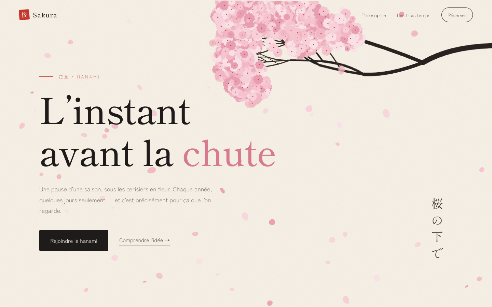
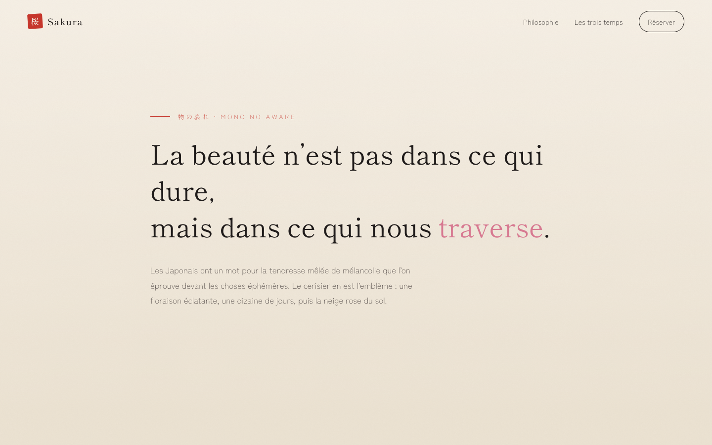
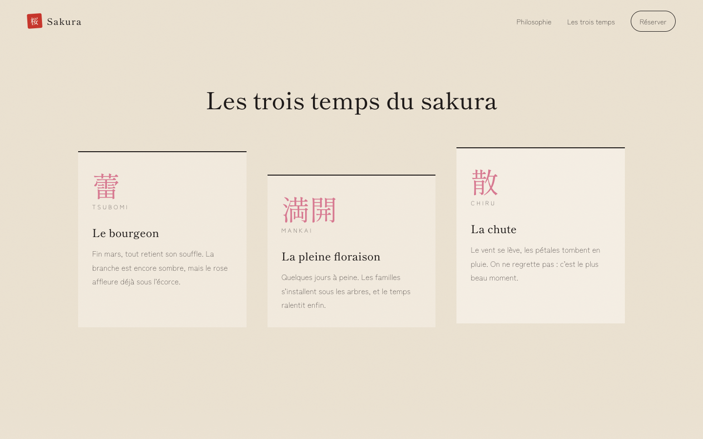
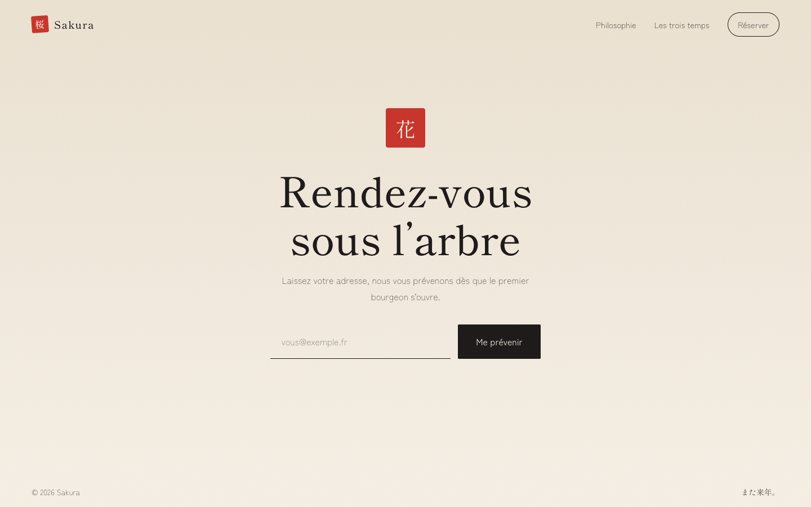
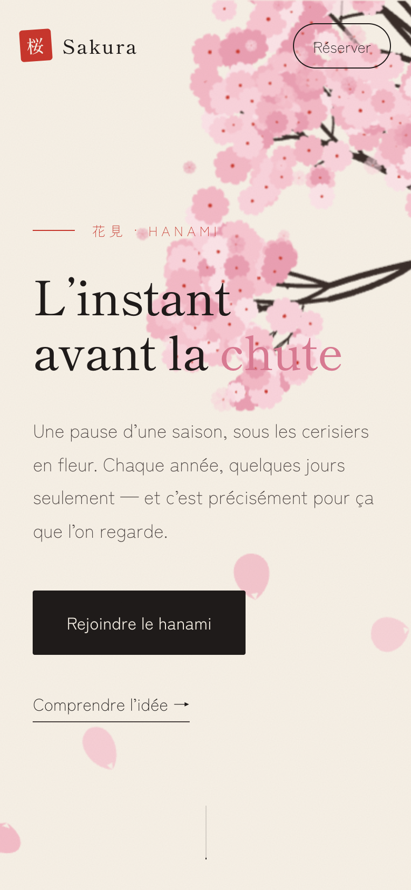

# Sakura Landing

A one-page landing site built with Vue 3 and themed around hanami, the Japanese custom of watching cherry blossoms. A cherry branch hangs in the corner and petals drift across the page, pushed sideways by a wind that follows your cursor.



## What it does

- The branch and its blossoms are generated in code and drawn once to an offscreen canvas, then reused on every frame. It sways a little and shifts as you scroll.
- Between 30 and 90 petals fall, depending on screen size. Each has its own speed, sway, spin and flip, which fakes a 3D tumble on a flat canvas.
- Moving the mouse across the screen pushes the petals sideways.
- The look is washi paper: a cream background with a light grain, ink-black text, a vermilion accent like a hanko stamp, vertical Japanese text, and Shippori Mincho for headings.
- If your system asks for reduced motion, the page draws one still frame and skips the animation.

| Philosophy | Three seasons | Sign-up |
| --- | --- | --- |
|  |  |  |

On phones the branch is shorter and the blossoms smaller, so the text stays readable.



## Getting started

You need Node 20 or later and [pnpm](https://pnpm.io).

```bash
pnpm install
pnpm dev        # http://localhost:5173
pnpm build      # production build in dist/
pnpm preview    # serve the production build
```

## Project layout

```
src/
├── sakura/              # canvas engine, no Vue dependency
│   ├── scene.js         # animation loop, resize handling, wind
│   ├── branch.js        # procedural branch, painted once offscreen
│   ├── blossom.js       # five-petal flower
│   ├── petal.js         # falling petal: spawn, update, draw
│   ├── palette.js       # colours
│   └── random.js        # seeded PRNG
├── components/          # one component per page section
├── directives/reveal.js # v-reveal: fade in on first scroll into view
├── content.js           # copy for the seasons section
└── style.css            # design tokens and shared styles
```

The engine in `src/sakura/` doesn't depend on Vue. `SakuraCanvas.vue` creates the scene on mount and calls `destroy()` on unmount, so you can reuse the engine in another project.

## Tweaking it

- Colours and fonts are CSS variables at the top of `src/style.css`. Petal colours are in `src/sakura/palette.js`.
- Petal count and wind strength are constants at the top of `src/sakura/scene.js`.
- The branch shape comes from the seed in `src/sakura/branch.js`. Change `SEED` to grow a different tree.
- The copy is in French. Edit `src/content.js` and the section components to change it.

## Notes

The sign-up form is a demo and doesn't send anything. Fonts load from Google Fonts.

## License

MIT
